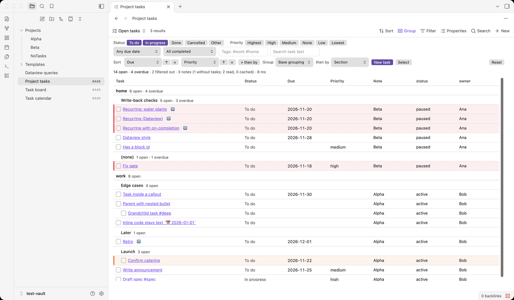
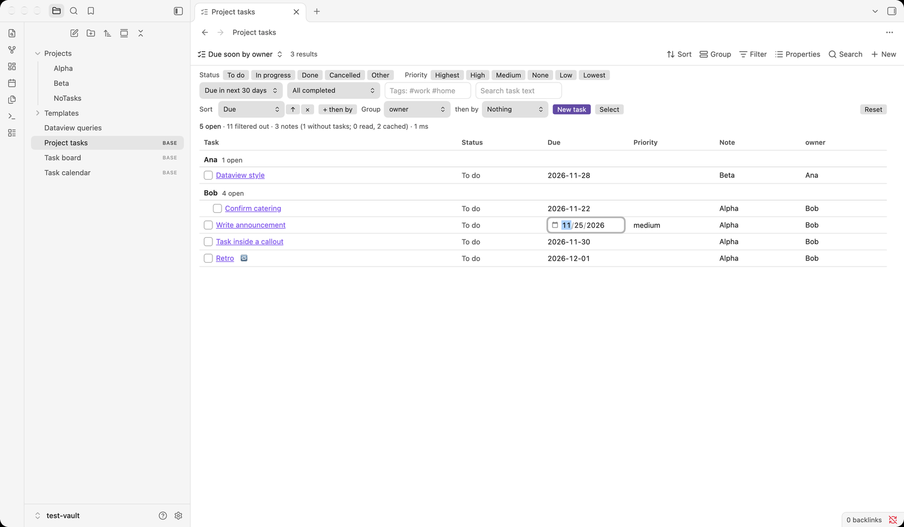
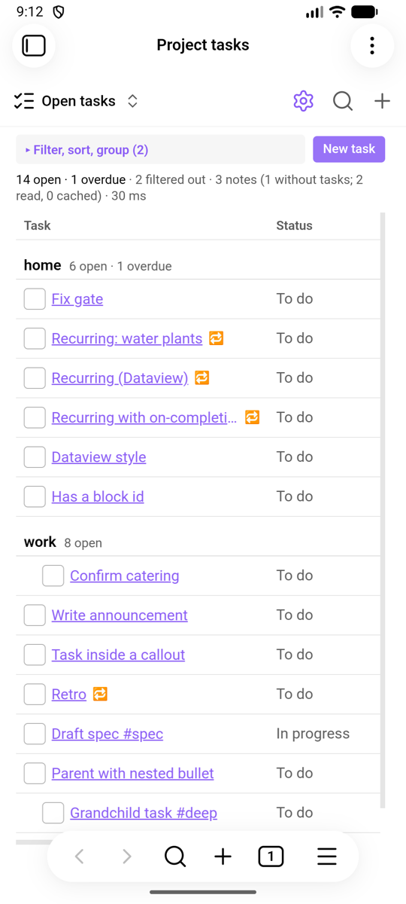
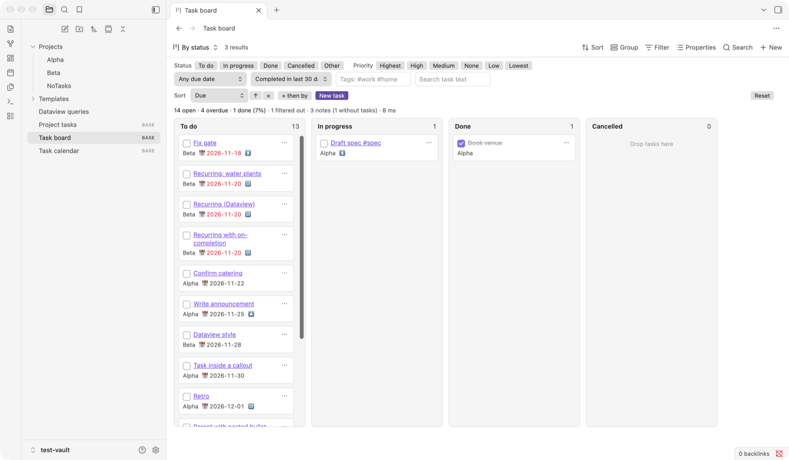
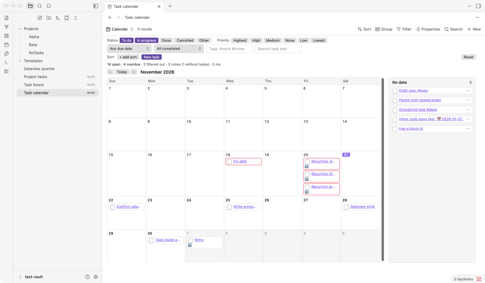
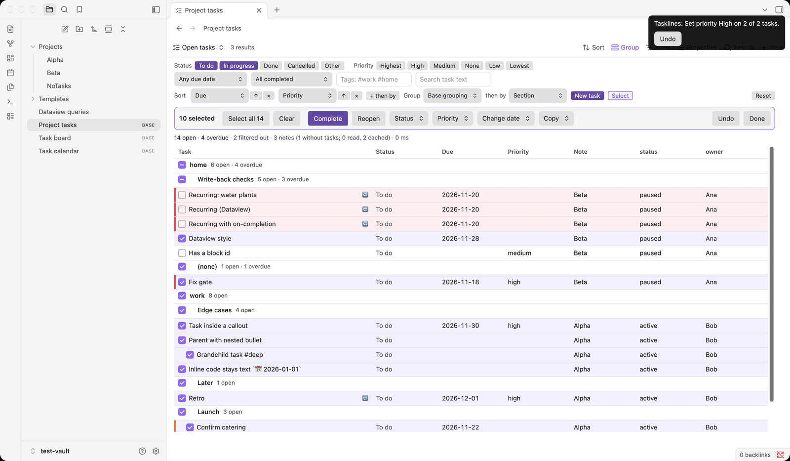
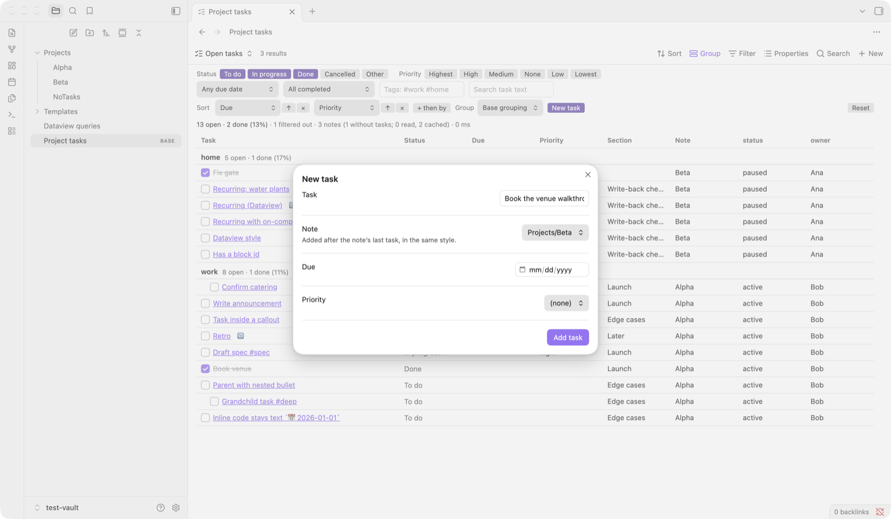

# Tasklines

**Your inline tasks as rows in Obsidian Bases.** Tasklines adds a view to Bases with one row per checkbox task in the notes a base selects, a task board with the same tasks as cards, and a task calendar. Each row carries its note's properties as columns. Filter, sort and group by task or note fields, then tick, edit and add tasks without leaving the view. Your notes stay in the formats you already use: Tasks plugin emoji or Dataview fields.





Please report problems on the [issue tracker](https://github.com/casazium/tasklines/issues).

## Install

**Community plugins:** search for "Tasklines" in **Settings → Community plugins → Browse**, then install and enable it.

**Beta versions, with BRAT:** install and enable the **BRAT** community plugin, choose **Add beta plugin** in its settings, enter `casazium/tasklines`, and enable **Tasklines** in **Settings → Community plugins**.

**Manually:** download `main.js`, `manifest.json` and `styles.css` from a [release](https://github.com/casazium/tasklines/releases) into `<vault>/.obsidian/plugins/tasklines/`, then enable the plugin.

Requires Obsidian 1.13 or newer with the **Bases** core plugin turned on. Works on desktop and mobile. On Obsidian 1.10 to 1.12, Obsidian offers version 1.0.2, the last release that supports them.



## Quick start

1. Create a base (**New base**), or open an existing one.
2. Use the base's **Filters** to pick the notes whose tasks you want, for example notes in your `Projects` folder.
3. Add a view and choose **Tasklines** as its layout.
4. In the base's **Properties** menu, pick the note properties to show as columns (for example `status` or `owner`).
5. Use the task toolbar to filter, sort and group the tasks.

A `.base` file with a Tasklines view looks like this:

```yaml
filters:
  and:
    - file.inFolder("Projects")
views:
  - type: tasklines
    name: Open tasks
    order: [file.name, note.owner]
    taskQuery:
      statuses: [todo, in-progress]
      due: next30
      sort:
        - key: due
          desc: false
      group: prop:note.owner
```

## Using the view

- **Notes vs tasks:** the base's own filters, sort and **Group by** work on notes. The task toolbar works on tasks:
  - **Filter** by status, priority, due date (overdue, today, next 7 or 30 days, has or has no due date, or a date range), completion window (completed today, in the last 7 or 30 days), tags (`#area` also matches `#area/home`) and task text.
  - **Sort** by up to three keys, each ascending or descending: any task date, priority, status, text, note name, base order, or any note property. Tasks with no value always sort last.
  - **Group** by the base's grouping, note, section (nearest heading), status, due bucket, priority, tag, or any note property. **then by** adds a second level inside each group, for example note then section, or due bucket then owner. Each second-level heading has its own counts, and in select mode its own checkbox. The board and the calendar use one level: their columns and days are the grouping.
- **On phones** the toolbar folds into one **Filter, sort, group** button, which shows how many settings are active, next to **New task**, so the tasks keep the screen. Tap it to open the controls.
- **Each view is a saved preset:** the toolbar's settings are stored in the `.base` file, so each view keeps its own. **Reset** clears them.
- **Columns:** note properties come from the base's **Properties** menu. Task columns (status, dates, priority, recurrence, tags, section, line, note) and computed columns (Overdue, Days until due, Age, Subtasks done, Note progress) are switched on in the view's config menu, which also has **Show task toolbar** (turn it off for embedded bases).
- **Counts:** group headers and the line above the table show open, overdue and done counts.
- **Color** (in the view's config menu, in the list, the board and the calendar) tints tasks with a bar on their leading edge and a faint wash, in your theme's colours:
  - **Due date:** overdue tasks red, tasks due today orange.
  - **Priority:** highest red, high orange, medium yellow, low blue, lowest cyan.
  - **Note property:** pick the property in **Color property**. Each value always gets the same colour (never red, which stays for overdue), so every task in a note shares its note's colour.
  - Finished tasks aren't tinted by due date or priority. Colour is an extra cue, not the only one: screen readers hear it in words (for example "overdue" or "area: home"), and the same facts can be shown as columns.
- **Open a task:** click its text to open the note at that line; Cmd/Ctrl-click opens a new tab.
- **Large vaults:** only the rows on screen are drawn, and each note is read once and cached until it changes.

## Task board

Add a view with the **Task board** layout to see the same tasks as cards in columns.

 In the view's config menu, **Columns** picks the field: **Status**, **Priority** or **Due date**. The task toolbar filters and sorts the cards, and sorting applies within each column.

- **Move a card** by dragging it to another column, or with its **⋯** menu (on phones, and from the keyboard). A move is one ordinary change to that one line, with the same checks as everywhere else:
  - **Status:** To do, In progress, Done and Cancelled. Moving to Done adds the completion date. A recurring task moved to Done is completed through the Tasks plugin, so it gets its next occurrence.
  - **Priority:** one column per priority, including No priority.
  - **Due date:** dropping on **Today** or **Tomorrow** sets the due date, and **No due date** clears it. **Overdue**, **Next 7 days** and **Later** cover ranges of dates, so they show tasks but don't accept drops. Finished tasks with a past due date sit in their own column instead of Overdue.
- **Undo:** after a move, the notice has an **Undo** button that puts the line back exactly as it was (unless it has changed since). Completing a recurring task can't be undone this way, because it adds the next occurrence.
- Custom statuses keep their place: a `[!]` task stays in To do. They aren't a drop target of their own, so moving it to another status replaces the custom status.
- Long columns show 100 cards at a time, with a **Show more** button.

A board view in a `.base` file:

```yaml
views:
  - type: tasklines-board
    name: Board
    boardField: status
    taskQuery:
      doneWithinDays: 7
```

## Task calendar

Add a view with the **Task calendar** layout to see tasks on the days of their dates.

 In the view's config menu:
- **Date** picks which date places a task: **Due**, **Scheduled** or **Start**.
- **Layout** picks **Month**, **Agenda** or **Automatic**. Automatic, the default, shows the agenda on phones and the month elsewhere, so one base suits both.

The task toolbar's filters and sort still apply.

- **Month:** a grid of weeks. It starts on the first day of the week for your Obsidian language. Use **‹**, **Today** and **›** to change month. A day shows three tasks, with **+N more** for the rest. Tasks without the date are in **No date**, beside the grid (below it on phones).
- **Agenda:** **Overdue** (open tasks only), then each of the next two weeks' days that has tasks, then **Later** and **No date**. On desktop the next seven days always show, as places to drop tasks.
- **Reschedule a task** by dragging it to another day, or with its **⋯** menu (on phones, and from the keyboard): Today, Tomorrow, One day later, One week later, **Pick a date…** and Remove date. Each is one ordinary date edit, in the line's own style, with the same checks as everywhere else. The notice offers **Undo**. Dropping a task on **No date** removes that date.
- A recurring task keeps its last date, so it always has one to repeat from.
- A date that isn't a real day (such as `2026-11-31`) shows the task under **No date** with the date marked, so you can fix it.
- Dates only: the calendar has no times of day and no reminders.

A calendar view in a `.base` file:

```yaml
views:
  - type: tasklines-calendar
    name: Calendar
    calendarField: due
    taskQuery:
      statuses: [todo, in-progress]
```

## Changing several tasks at once



Press **Select** in the task toolbar of any Tasklines view (list, board or calendar); it stays highlighted while select mode is on, and pressing it again (or **Done**, or Escape) leaves. Each task's checkbox becomes a selection box, and tapping a task selects it too. To select several at once:

- **Shift-click** a task to select (or unselect) everything from the last task you ticked to this one, in the order they appear on screen.
- The checkbox at the start of a list group, board column or calendar day selects every task under it, and shows a dash when only some are selected.
- **Select all** selects every task the view's filters show.

An action bar appears above the tasks and stays there as they scroll. From left to right:

- What's selected: the count, **Select all** and **Clear**.
- The actions: **Complete**, **Reopen**, **Status**, **Priority**, **Change date** and **Copy**.
  - **Change date** has Today, Tomorrow, One day later, One week later, Pick a date… and Remove for each of the due, scheduled and start dates (a calendar's own date first). "One day later" moves each task's own date (counting from today once it has passed), and skips tasks with no date.
  - **Copy** puts the selected tasks on the clipboard as a plain list with a link to each task's note (no checkboxes, so pasting it doesn't make copies of the tasks), or as the task lines themselves.
- **Undo** and **Done**. Undo is always in the same place, and is greyed out when there's nothing to undo.

On a phone the bar is two rows: the count, **Select all**, **Undo** and **Done**, then **Complete**, **Date** and **More** (Reopen, Status, Priority, Copy and Clear).

Each selected task is still changed on its own, one line at a time, with the same checks as everywhere else. If a line changed since you selected it, that task is refused and the rest go ahead. Tasks with nothing to change are skipped. One notice reports what was done, skipped and refused, and **Undo** (in the notice and in the action bar) puts every changed line back, each only if it's still what the batch wrote.

Batches of more than 20 tasks ask first. So do batches that complete a recurring task: those go through the Tasks plugin, which adds the next occurrence, so Undo can't take them back.

## Completing, editing and adding tasks

Every change follows the same safety rule. Tasklines re-reads the note and checks that the line is still exactly what the view showed. It then writes through Obsidian's atomic `Vault.process`, changing only that line. If anything differs (you edited the line, it moved, the note was renamed), nothing is written, and a notice with an **Open at line** button appears.

- **Tick a checkbox** to complete or reopen a task. A completion date is added in the line's own style: `✅ 2026-11-20` or `[completion:: 2026-11-20]`. Unticking removes it. Cancelling a task adds a cancelled date the same way (`❌ 2026-11-20` or `[cancelled:: 2026-11-20]`), and reopening it removes that date.
- **Click a Status, Due, Scheduled, Start or Priority cell** to edit it. Existing fields are changed where they are. New ones go at the end of the line, before any `^block-id`. Text in `inline code` is never touched.
- **New task** adds one line to any note in the base, after the note's last task (and anything nested under it), in the same style and inside the same callout. A note without tasks gets it at the end.



## Works with the Tasks plugin

- **Completion:** when the Tasks plugin (7.2.0 or later) is enabled, Tasklines asks it to complete tasks. Recurrence, done dates and custom status transitions then follow your Tasks settings, and a recurring task gets its next occurrence exactly as it would in the editor.
- **Formats:** Tasks reads one format at a time (emoji or Dataview). If it's set to the other format than a line uses, Tasklines never writes the mixed result. One-off tasks are completed by Tasklines itself; recurring ones are refused, so the next occurrence is never lost.
- **Without Tasks:** recurring tasks (marked 🔁) can't be completed from the view; open the note to complete them. Everything else works.

## Supported task syntax

Any list item Obsidian recognizes as a task: a `-`, `*`, `+` or numbered list item, with any status character, including inside block quotes and callouts.

| Field | Tasks plugin emoji | Dataview inline field |
| --- | --- | --- |
| Due | `📅` `📆` `🗓` | `[due:: 2026-01-01]` |
| Scheduled | `⏳` `⌛` | `[scheduled:: …]` |
| Start | `🛫` | `[start:: …]` |
| Created | `➕` | `[created:: …]` |
| Done | `✅` | `[completion:: …]` |
| Cancelled | `❌` | `[cancelled:: …]` |
| Priority | `🔺` `⏫` `🔼` `🔽` `⏬` | `[priority:: high]` |
| Recurrence | `🔁 every week` | `[repeat:: every week]` |
| ID / depends on / on completion | `🆔` `⛔` `🏁` | |

Also read: `#tags`, `[[wikilinks]]`, a trailing `^block-id`, any other `[key:: value]` or `(key:: value)` field, the nearest heading and subtask nesting. Checkboxes in code blocks are ignored.

## Moving from Dataview

Put the cursor inside a ```` ```dataview ```` block that starts with `TASK` and run **Convert Dataview task query under cursor to a base**. Tasklines creates `<note> tasks.base` next to the note and opens it. Your note isn't changed; embed the base with `![[<note> tasks.base]]` when you're happy with it.

| Dataview | Tasklines |
| --- | --- |
| `FROM "folder"`, `#tag`, `-"folder"`, `AND` / `OR` | Base filters `file.inFolder()`, `file.hasTag()` |
| `WHERE !completed` / `completed` / `status = "/"` | Status filter |
| `due < date(today)`, `= date(today)`, `<= date(today) + dur(7 days)` (or 30), `due >= date(2026-01-01)` | Due filter: overdue, today, next 7/30 days, date range |
| `contains(text, "…")`, `contains(tags, "…")` | Text and tag filters |
| `project = "Alpha"` | Base filter `note.project == "Alpha"` |
| `SORT due ASC, priority DESC` | Up to 3 sort keys |
| `GROUP BY file.link`, `status`, `section` | Group by note, status, section |

Anything else (`OR` inside `WHERE`, `LIMIT`, `FLATTEN`, link sources, custom functions) is listed at the top of the new file to fix by hand.

## Settings

- **Completion date** on or off, and whether to **let the Tasks plugin complete tasks**.
- **Style for new fields on plain tasks:** Tasks emoji (`📅 2026-01-31`) or Dataview fields (`[due:: 2026-01-31]`). Tasks that already have a style keep it.
- **Task statuses:** one per line, `character | name | kind`, where kind is `todo`, `in-progress`, `done`, `cancelled` or `other`. Space, `x` and `-` always mean to do, done and cancelled.
- **Excluded folders:** notes in these folders are never indexed (for example `Templates`).

## Privacy

Tasklines works entirely inside your vault. It makes no network requests, collects no data, and changes notes only when you tick, edit or add a task. It touches the clipboard only when you press **Copy** in select mode, which writes the selected tasks to it; it never reads the clipboard. Turning the plugin off leaves every note and `.base` file as plain, valid Markdown and YAML.

## Known limits

- Task fields can't appear in Bases' own filter, sort or group menus, because the Bases API only allows note, file and formula properties. That's why the task toolbar exists.
- Task text, tags and recurrence rules can't be edited in the view yet. Open the note for those.
- Rows have a fixed height. Long text is cut off with an ellipsis, and the full text is in the tooltip.
- Sorting and grouping by a note property use the value's displayed text, with numbers in natural order (`9` before `10`).
- In files with old Mac line endings (CR only), a change may be refused if Obsidian numbers lines differently. Tasklines never writes to the wrong line.
- A change to a line with repeated or competing fields (two priorities, or a date written both as an emoji and as a Dataview field) is refused if the line wouldn't read back exactly as asked. Make that change in the note.

## Development

Needs Node 22.18 or newer. CI builds, lints and tests on Node 22 and 24.

```bash
npm ci
npm run build   # type-check and bundle to main.js
npm test        # parser fixtures, write-back safety and feature tests
npm run lint
npm run bench   # index and query timing on a synthetic vault
```

- [CONTRIBUTING.md](CONTRIBUTING.md): how to report a problem and get a change accepted.
- [AGENTS.md](AGENTS.md): code layout and the rules every change must keep.
- [VERIFY.md](VERIFY.md): manual checks in Obsidian; `test-vault/` has material for each.
- [RELEASE.md](RELEASE.md): how to cut a release and the community-submission checklist.
- [SPIKE.md](SPIKE.md): the Bases API findings behind the design.

## License

[MIT](LICENSE) © 2026 Bob Casazza
